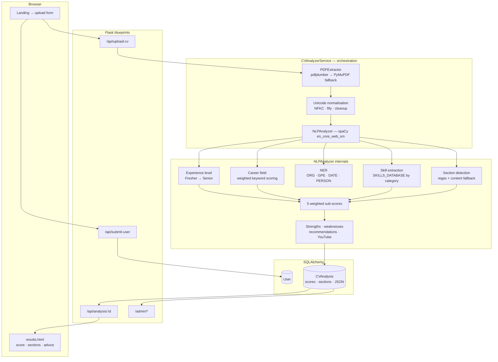

<div align="center">


# 📄 IntelliCV

### An NLP CV analyser that explains its own score

*Extract text from any PDF résumé, detect its nine sections, pull out skills and entities with spaCy, and return a weighted 0–100 score with the reasoning attached — plus the recommendations needed to raise it.*

<br/>

[](https://python.org)
[](https://flask.palletsprojects.com)
[](https://spacy.io)
[](https://sqlalchemy.org)
[](https://tailwindcss.com)
[](https://docker.com)

[](https://huggingface.co/spaces/Zaki47/Intellicv)
[](#-the-nine-sections)
[](#-the-scoring-model)
[](#-does-it-actually-work)

</div>

---

## The problem

A résumé gets about seven seconds of a recruiter's attention, and the candidate never finds out which seven seconds failed. Most online "CV checkers" answer with a number and nothing else — a 68/100 that tells you nothing about what to change.

IntelliCV is built the other way round. Every score it produces decomposes into five weighted categories, each category decomposes into the evidence that produced it, and each weakness maps to a concrete recommendation and a search query for learning material. The number is the *summary* of the analysis, not the product of it.

> Upload a PDF → the text is extracted, the sections are located, the skills and entities are pulled out, five sub-scores are computed → you get a score, a strengths/weaknesses split, and a list of things to fix.

---

## Why this project is worth a look

| | |
|---|---|
| **Extraction has a fallback path** | `pdfplumber` handles complex multi-column layouts; if it returns under 50 usable characters the extractor falls back to PyMuPDF and records which method won in the analysis metadata |
| **Unicode is treated as a real problem** | Résumé PDFs are full of ligatures, smart quotes, and broken encodings. Text passes through NFKC normalisation and repair before any NLP touches it — garbage in is caught before it becomes garbage out |
| **Hybrid section detection** | Sections are found first by regex over ~40 heading variants, then — if the heading is missing entirely — by *content* inspection, so a CV with no "Skills" header still gets a skills section |
| **Every score is explainable** | Each of the nine sections carries a quality score *and* a generated explanation string. The result page shows the reasoning, not just the verdict |
| **It is validated against ground truth** | `tests/accuracy_validator.py` runs the analyser over labelled synthetic CVs and reports per-metric accuracy — with the failures left visible in the committed reports |
| **Full admin layer** | Submissions, users, per-analysis inspection, and CSV export — the app is an operational tool, not a single-endpoint demo |

---

## 🏗️ Architecture



---

## 🧠 The pipeline, stage by stage

| Stage | Component | What it actually does |
|---|---|---|
| Validation | `PDFExtractor.validate_pdf` | Header check (`%PDF`), page count, encryption and size guards before anything is parsed |
| Extraction | `pdfplumber` → `PyMuPDF` | Primary extractor for layout-heavy CVs, automatic fallback when it yields too little text |
| Normalisation | `unicodedata` · `ftfy` · `regex` | NFKC folding, mojibake repair, whitespace and bullet normalisation |
| Sections | `_detect_sections` | Regex patterns per section, then `_detect_section_by_content` for unlabelled blocks |
| Skills | `_extract_skills` | Matching against a categorised skills database — the *number of distinct categories* also feeds the score |
| Entities | `_extract_entities` | spaCy NER for organisations, locations, dates, and people |
| Career field | `_detect_career_field` | Weighted match: job titles ×10 (+5 if in the header), multi-word primaries ×6, primaries ×4, secondaries ×2, plus a frequency bonus |
| Level | `_detect_experience_level` | Fresher / Junior / Mid-Level / Senior, inferred from the experience section and duration cues |
| Advice | `_generate_recommendations` | Weakness → concrete fix → YouTube search suggestion |

---

## 📊 The scoring model

Five categories, each computed to 0–100, then combined:

| Category | Weight | How it's earned |
|---|---|---|
| **Experience level** | 25% | Base by level (Fresher 40 → Senior 100), plus 3× the work-experience section's quality score |
| **Skills relevance** | 25% | 8 points per distinct skill, plus 5 per skill *category* covered — breadth is rewarded, not just count |
| **Structure & completeness** | 20% | 12 points per section detected (9 possible), plus 2× the mean section quality |
| **Career alignment** | 15% | 70 for a confidently identified field, +5 per skill matching that field's keywords; 50 for a generic profile |
| **Readability & clarity** | 15% | Peaks at 300–800 words, +15 when at least five bullet points are present |

```
overall = 0.25·experience + 0.25·skills + 0.20·structure + 0.15·career + 0.15·readability
```

The weights are the design decision worth arguing with: skills and experience together carry half the score, which suits technical CVs and would need retuning for other fields.

---

## 📑 The nine sections

Professional Summary · Education · Work Experience · Internship Experience · Skills · Projects · Certifications · Achievements · Hobbies & Interests

Each is reported with three fields — `detected`, `quality_score`, and a human-readable `explanation` — so a missing *Projects* section and a thin one are visibly different outcomes.

---

## 🔬 Does it actually work?

`tests/accuracy_validator.py` runs the full analyser over labelled synthetic CVs spanning several fields and seniority levels, then checks five independent properties. From the last committed run (`tests/reports/`):

| Metric | Accuracy |
|---|---|
| Score in expected range | 100% |
| Career field | 100% |
| Section detection | 100% |
| Skill extraction | 100% |
| **Experience level** | **57.1%** |
| **Average** | **91.4%** |

The strict pass rate — every metric correct on the same CV — is 4/7. The single failure mode is real and worth naming: a senior software engineer's CV scored 89.98 with all six required skills and seven sections found, but was classified **Junior**. Seniority inference leans on duration cues that a CV written in a "Jan 2019 – Present" style doesn't always give up. That is the next thing to fix, and the reports are committed rather than trimmed so the gap stays visible.

---

## 🔌 API

| Method | Route | Purpose |
|---|---|---|
| `POST` | `/api/submit-user` | Register candidate details, returns `user_id` |
| `POST` | `/api/upload-cv` | Upload the PDF and run the analysis, returns `analysis_id` + redirect |
| `POST` | `/api/validate-pdf` | Cheap pre-flight check — extension and `%PDF` header — before the real upload |
| `GET` | `/api/analysis/<id>` | Full analysis payload |
| `GET` | `/api/analysis/<id>/summary` | Compact version: score, level, field, counts, processing time |
| `GET` | `/api/stats` | Total users, total analyses, mean score |

The API blueprint is CSRF-exempt by design (it takes JSON and `FormData`); the HTML forms and admin panel are not.

---

## 🚀 Running it

**Docker — the way it runs in production**

```bash
docker build -t intellicv . && docker run -p 7860:7860 intellicv
```

The image installs system deps for PyMuPDF and `pdf2image`, downloads `en_core_web_sm` at build time, and serves through gunicorn (2 workers, 120s timeout) on port 7860.

**Locally**

```bash
python -m venv venv && source venv/bin/activate
pip install -r requirements.txt
python -m spacy download en_core_web_sm
cp .env.example .env
python run.py
```

App on `http://127.0.0.1:5000`, admin on `/admin`. `create_db.py` initialises the schema. MySQL is the configured backend — `config.py` reads `MYSQL_*` from the environment.

> **Change the defaults.** `.env.example` ships `admin` / `admin123` and a placeholder `SECRET_KEY`. They are convenience values for first boot, not credentials.

---

## ⚠️ Known issues

<details>
<summary><b>An honest list</b></summary>

<br/>

1. **Experience-level detection is the weak link** — 57% on the validation set, and it is 25% of the total score. Parsing explicit date ranges into a years-of-experience figure would fix most of it.
2. **Skill scoring saturates fast.** At 8 points each, 13 skills max out the category. A CV listing 40 technologies and one listing 13 score identically.
3. **The skills database is a fixed list.** Anything not in `SKILLS_DATABASE` is invisible, so newer tools are silently missed. Embedding-based matching would generalise.
4. **Uploaded PDFs are retained** in `uploads/` and the extracted text is stored in full in the database. For anything beyond a demo that needs a retention policy and a consent step.
5. **`transformers`, `torch`, and `sentence-transformers` are installed but the analysis path is spaCy + rules.** That is a heavy image for capability not yet used — either use it for semantic section matching or drop it.
6. **Uploads directory is `chmod 777`** in the Dockerfile. Fine inside an ephemeral container, wrong anywhere else.

</details>

---

## 🛠️ Stack

**Backend** · Python 3.13 · Flask 3 · SQLAlchemy 2 · Flask-Login · Flask-WTF · gunicorn
**NLP** · spaCy `en_core_web_sm` · scikit-learn
**PDF** · pdfplumber · PyMuPDF · pdf2image · poppler
**Text** · ftfy · regex · chardet · unicodedata2
**Frontend** · Jinja2 · Tailwind CSS · PDF.js
**Deploy** · Docker · Hugging Face Spaces (port 7860)

---

<div align="center">

**Ahcene Zakaria Aouanouk** — Data Science & AI student, Algiers

[](https://huggingface.co/spaces/Zaki47/Intellicv)
[](https://www.linkedin.com/in/ahcene-zakaria-aouanouk-1126902b7/)
[](mailto:zzaouanouk@gmail.com)

</div>
